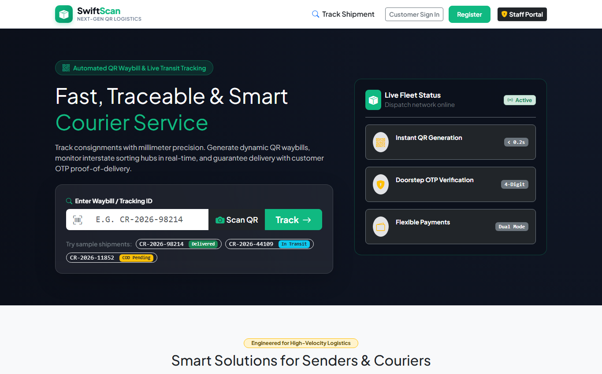
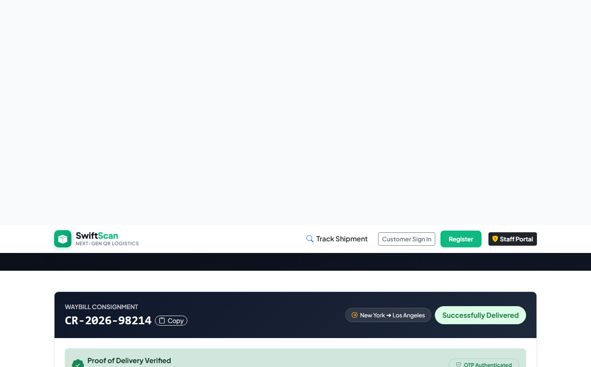
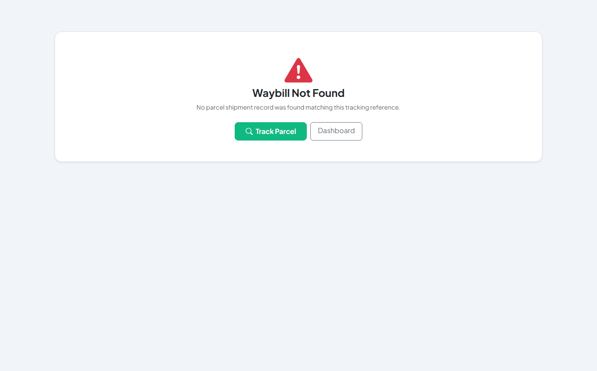
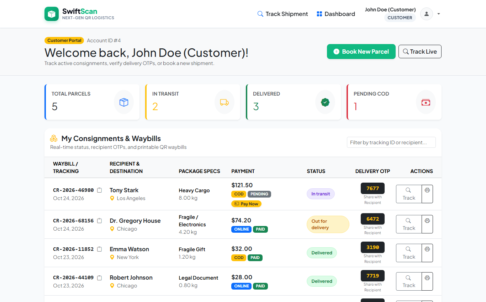
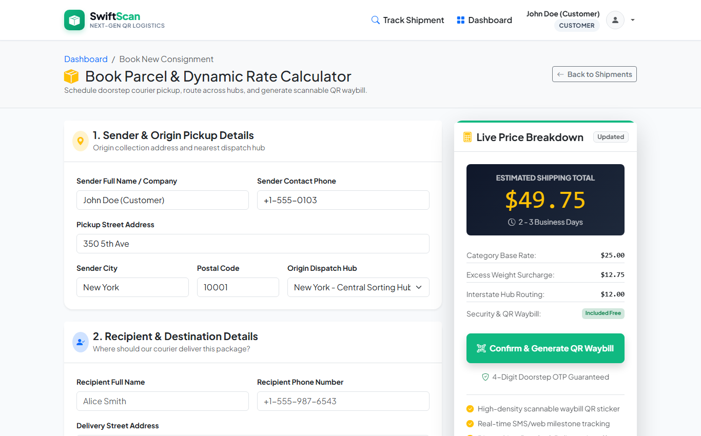
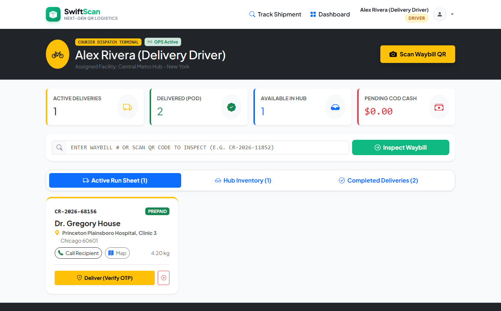
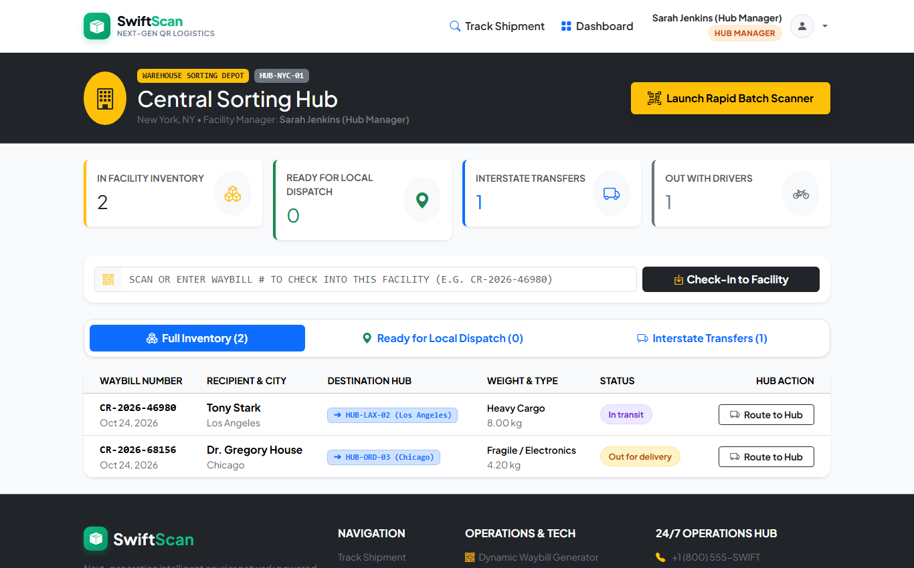
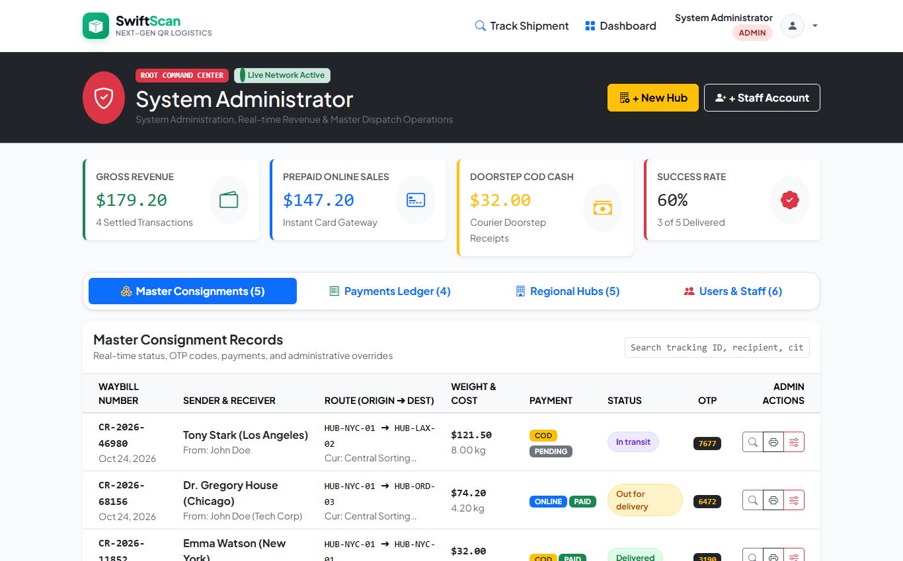
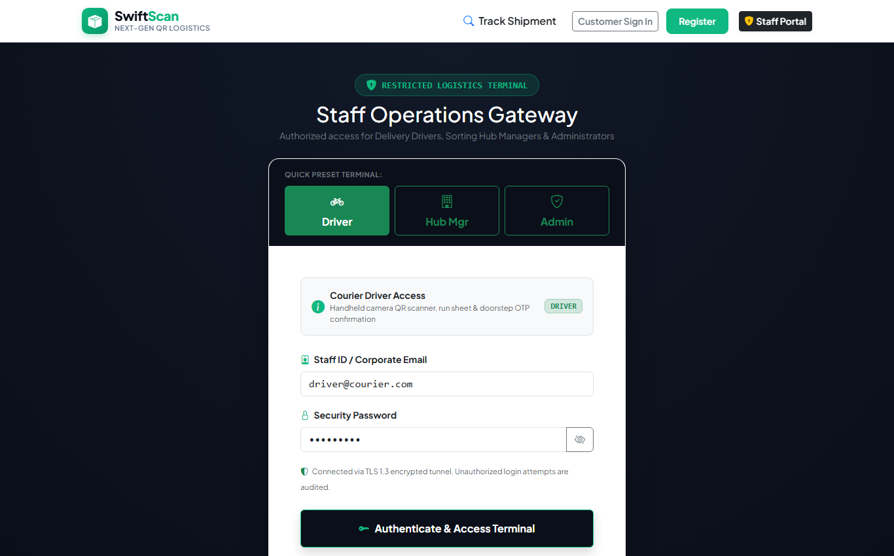
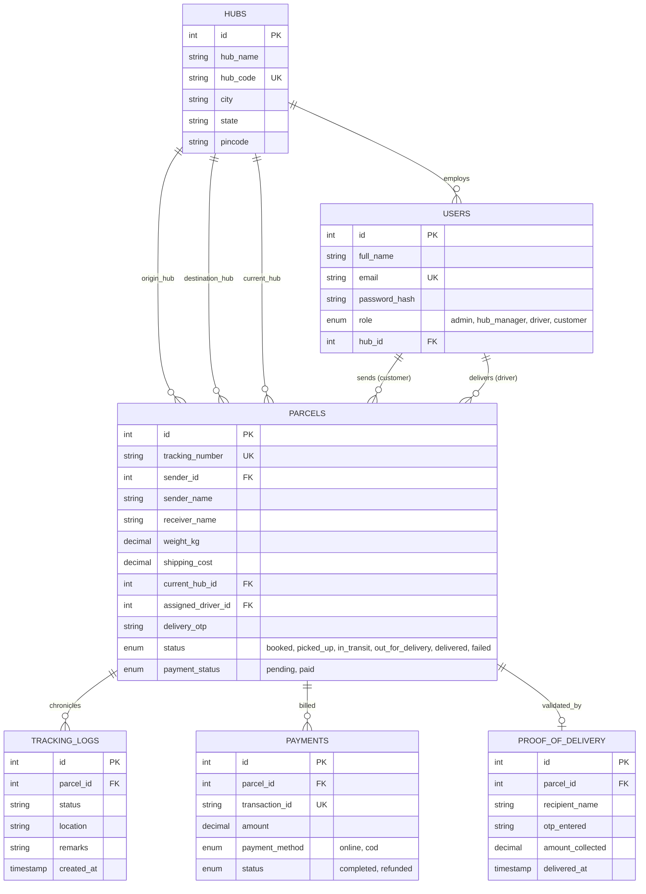

# 📦 SwiftScan Express - Courier Service & Parcel Management System with QR Code

<div align="center">


<p align="center">
  <b>A modern, enterprise-ready logistics platform featuring real-time waypoint tracking, dynamic vector QR waybills, rapid camera barcode/QR scanning, and anti-fraud 4-digit doorstep OTP Proof of Delivery.</b>
</p>

</div>

---

## 📸 Screenshots Showcase

<div align="center">

### 🌐 Public Live Tracking with 4-Stage Animated Milestone Stepper


<br/>

### 📍 Consignment Milestone Stepper & Audit Log


<br/>

### 🏷️ 4" x 6" Thermal Printable QR Waybill Shipping Label
*Standard 4x6 courier thermal sticker (`@media print`) with scannable QR code, barcode simulation, and destination hub routing box.*



<br/>

### 👥 Customer Self-Service Portal & Active Consignments


<br/>

### ⚖️ Real-Time Dynamic Parcel Rate & Distance Estimator


<br/>

### 🚚 Courier Driver Handheld Run Sheet & Camera QR Scanner
*Features live delivery status controls, GPS mapping triggers, and recipient 4-digit OTP modal verification.*



<br/>

### 🏢 Regional Sorting Hub Intake & Interstate Transit Dispatcher


<br/>

### 👑 Super Admin Command Center & Revenue Analytics


<br/>

### 🛡️ Logistics Operations Gateway with 1-Click Role Presets


</div>

---

## ✨ Core Highlights & Technical Architecture

### 1. 🖨️ Dynamic QR Waybill & Thermal Label Printing
- **Client-Side Vector QR Generation**: High-density QR generated instantly via `QRCode.js` with zero server overhead.
- **Universal Mobile Camera Recognition**: Any native smartphone camera app scanning the waybill sticker instantly opens the consignment's live tracking URL.
- **Standard 4" x 6" Thermal Print CSS**: Styled with `@media print` rules for direct output to thermal roll printers (e.g., Zebra, Rollo, MUNBYN).

### 2. 📷 Multi-Mode Camera QR Scanning (WebRTC HTML5-QRCode)
- **Courier Driver Mobile Handheld Mode**: Couriers scan parcels directly at the recipient's doorstep using their phone browser camera.
- **Hub Continuous Rapid Batch Intake**: Sorting center managers scan incoming pallets rapidly with duplicate-scan prevention and an auto-refreshing intake table.

### 3. 🔐 Anti-Fraud Doorstep Proof of Delivery (POD) via 4-Digit OTP
- Every booked parcel generates a unique **cryptographic 4-digit delivery OTP** accessible only to sender and recipient.
- Couriers **cannot** mark a consignment delivered without entering the customer's secret OTP.
- The delivery record logs recipient signature name, cash settlement, driver system ID, and exact GPS timestamp.

### 4. 🎛️ Strict Role-Based Access Control (RBAC) & Split Portals
- **Customer Self-Service Portal** (`login.php` / `register.php` / `/customer/`): Book shipments, calculate rates dynamically, reveal secret OTPs, and download QR waybills.
- **Logistics Operations Gateway** (`staff_login.php`): Hardened staff gateway featuring 1-click credential presets for:
  - 🚚 **Delivery Drivers** (`/driver/`): Daily run sheet, turn-by-turn routing shortcuts, camera scanner, and OTP confirmation.
  - 🏢 **Hub Managers** (`/hub/`): Warehouse stock levels, continuous batch intake scanner, and interstate transfers.
  - 🛡️ **Super Administrators** (`/admin/`): Revenue dashboards, financial ledgers, consignment master directory, hub creation, and staff provisioning.

### 5. 💳 Dual Payment Processing Engine
- **Prepaid Online Card Checkout**: Interactive credit card visual widget with auto-formatted 16-digit spacing, MM/YY expiry, CVV validation, and 1-click test card filler (`4242 4242 4242 4242`). Generates `TXN_2026_XXXX_ONL` receipts.
- **Cash on Delivery (COD)**: Recipient pays the courier upon arrival. Handover is recorded in the POD ledger with automatic `TXN_2026_XXXX_COD` generation.

---

## 🗄️ Database Architecture (`courier_db`)

The system runs on a normalized relational schema with foreign key constraints, cascading updates, and indexing:



---

## 🚀 Quick Setup & Installation Guide

### Prerequisites
- **Web Server**: Apache (XAMPP / WampServer / LAMP / Docker)
- **PHP Version**: PHP 8.0 or higher with PDO and OpenSSL extensions enabled
- **Database**: MySQL 5.7+ or MariaDB 10.4+
- **Modern Web Browser**: Chrome, Edge, Firefox, or Safari (WebRTC camera permissions required for scanner)

---

### Step 1: Clone or Copy the Repository
Place the project directory into your web server's document root:

#### Windows (XAMPP):
```powershell
cd C:\xampp\htdocs
git clone https://github.com/Yashbanda18052003/courier_service_system.git
```

#### Linux / macOS:
```bash
cd /var/www/html # or ~/Sites on macOS
git clone https://github.com/Yashbanda18052003/courier_service_system.git
```

---

### Step 2: Database Initialization

1. Start your **Apache** and **MySQL** services via the XAMPP Control Panel or CLI:
   ```bash
   # Linux
   sudo systemctl start apache2 mysql
   ```
2. Open **phpMyAdmin** at `http://localhost/phpmyadmin/` or open your terminal:
   ```bash
   # Import database using MySQL CLI:
   mysql -u root -p -e "CREATE DATABASE IF NOT EXISTS courier_db CHARACTER SET utf8mb4 COLLATE utf8mb4_unicode_ci;"
   mysql -u root -p courier_db < database/schema.sql
   ```
   *(Alternatively, import `database/courier_db.sql` directly into phpMyAdmin).*

---

### Step 3: Configure Database Credentials

Open `config/db.php` and verify your database connection settings:

```php
// config/db.php
$host     = '127.0.0.1';
$dbname   = 'courier_db';
$username = 'root';
$password = ''; // Default in XAMPP is empty
```

---

### Step 4: Launch Application

Access the application in your browser:
```
http://localhost/courier_service_system/
```

---

## 🔐 Default Demo Accounts & Credentials

For rapid demonstration and testing, use the following pre-configured credentials:

| Role | Portal URL | Demo Email | Demo Password | Quick Action |
|:---|:---|:---|:---|:---|
| **Super Admin** | [`staff_login.php`](http://localhost/courier_service_system/staff_login.php) | `admin@courier.com` | `admin123` | Click **Admin** preset |
| **Hub Manager** | [`staff_login.php`](http://localhost/courier_service_system/staff_login.php) | `hub@courier.com` | `hub123` | Click **Hub Mgr** preset |
| **Courier Driver** | [`staff_login.php`](http://localhost/courier_service_system/staff_login.php) | `driver@courier.com` | `driver123` | Click **Driver** preset |
| **Customer** | [`login.php`](http://localhost/courier_service_system/login.php) | `customer@courier.com` | `customer123` | Click **Demo Fill** |

---

## 🧪 Interactive Testing Walkthrough

Follow this 5-minute end-to-end verification scenario:

### 1. Public Live Tracking Check
- Visit `http://localhost/courier_service_system/`
- Enter sample tracking code **`CR-2026-98214`** and click **Track**.
- Inspect the 4-stage animated stepper, current milestone, and chronological audit trail.

### 2. Book a Consignment as Customer
- Sign in at `login.php` using the **Demo Fill** button.
- Click **Book Shipment** in the sidebar.
- Choose destination city, package category, and input weight (e.g. `4.5 kg`). Watch the rate calculate dynamically.
- Submit the booking and click **Print QR Waybill** to view the thermal shipping label.

### 3. Process Card Payment
- In your customer dashboard or checkout page, click **Pay Now**.
- Use the **Auto-fill Test Card** button (`4242 4242 4242 4242`) and click **Confirm & Pay $XX.XX**.
- Notice the instant status transition from **Pending** to **Paid** with reference `TXN_2026_XXXX_ONL`.

### 4. Hub Sorting & Dispatch
- Log into `staff_login.php` with the **Hub Mgr** preset.
- Arrive packages at your hub using the **Rapid Batch Scanner** or by clicking **Arrive at Hub**.
- Re-route or transfer the parcel toward the destination hub.

### 5. Driver Doorstep Delivery with OTP
- Log into `staff_login.php` with the **Driver** preset.
- Locate the parcel in your active **Run Sheet**.
- Click **Deliver Package**. The modal requests the recipient's **4-digit OTP**.
- Input the secret OTP (revealed in the customer portal, e.g. `4821`).
- The system confirms delivery, registers recipient proof of delivery, and updates public tracking to **Delivered**!

---

## 📂 Project Directory Structure

```
courier_service_system/
├── admin/
│   └── index.php                # Super Admin root dashboard & analytics
├── ajax/
│   ├── admin_handler.php        # Hub and user provisioning endpoints
│   ├── auth_handler.php         # Customer and staff authentication endpoints
│   ├── hub_handler.php          # Sorting hub batch scan and dispatch endpoints
│   ├── parcel_handler.php       # Live tracking lookup and booking calculation
│   ├── payment_handler.php      # Online card processor and COD recorder
│   └── scan_handler.php         # Driver QR scans and OTP POD validator
├── assets/
│   ├── css/
│   │   └── style.css            # Custom Emerald & Obsidian logistics theme
│   └── js/
│       └── app.js               # Global AJAX engine, toasts, and tracking helpers
├── config/
│   └── db.php                   # Secure PDO database connection
├── customer/
│   ├── book.php                 # Parcel booking and dynamic rate calculator
│   ├── index.php                # Customer consignment dashboard
│   └── payment.php              # Dedicated checkout terminal
├── database/
│   ├── courier_db.sql           # Full SQL dump with tables & seed records
│   └── schema.sql               # Clean schema initialization script
├── driver/
│   └── index.php                # Driver run sheet, camera QR scanner, and OTP POD
├── hub/
│   └── index.php                # Sorting hub intake and transit dispatcher
├── includes/
│   ├── auth_guard.php           # Role-based access control (RBAC) guard
│   ├── footer.php               # Universal footer, script loader & scanner modal
│   ├── header.php               # HTML head, typography, Bootstrap & meta
│   ├── navbar.php               # Role-aware adaptive navigation bar
│   └── payment_modal.php        # Reusable card payment modal
├── screenshots/                 # High-resolution application screenshots
│   ├── 01_hero_tracking.png
│   ├── 02_live_stepper_tracking.png
│   ├── 03_waybill_thermal_label.png
│   ├── 04_customer_portal.png
│   ├── 05_parcel_booking_calculator.png
│   ├── 06_driver_runsheet.png
│   ├── 07_hub_dispatch.png
│   ├── 08_admin_command_center.png
│   ├── 09_staff_login_presets.png
│   └── 10_customer_login.png
├── index.php                    # Public tracking & marketing landing page
├── login.php                    # Customer login portal
├── logout.php                   # Secure session termination
├── register.php                 # Customer registration with instant login
├── staff_login.php              # Staff operations gateway (Driver, Hub, Admin)
├── waybill_print.php            # 4" x 6" Thermal courier QR shipping waybill
└── README.md                    # Project documentation
```

---

## 🛡️ Security Features
- **SQL Injection Prevention**: 100% of SQL queries utilize parameterized PDO prepared statements.
- **Cross-Site Scripting (XSS)**: Output sanitized with `htmlspecialchars(..., ENT_QUOTES, 'UTF-8')`.
- **Password Security**: Password storage powered by PHP's native `password_hash()` utilizing bcrypt with salt.
- **Tamper-Proof Proof of Delivery**: Deliveries cannot be marked completed without matching the cryptographically stored 4-digit recipient OTP.
- **Session Protection**: Strict server-side RBAC session guards protect admin, hub, driver, and customer routes.

---

## 🤝 Contributing

Contributions are welcome! Please follow these steps:
1. Fork the Project
2. Create your Feature Branch (`git checkout -b feature/AmazingFeature`)
3. Commit your Changes (`git commit -m 'Add some AmazingFeature'`)
4. Push to the Branch (`git push origin feature/AmazingFeature`)
5. Open a Pull Request

---

## 📄 License

Distributed under the **MIT License**. See `LICENSE` for more information.

---

<div align="center">
  <b>Built with ❤️ by Yash Banda</b>
</div>
